**4sh · aspiring developer.** I learn by building — small Python programs first, then web applications, dashboards, Discord bots and desktop tools. Most of what I know comes from practice projects, documentation, and rebuilding whatever broke the night before.

I'm a future Computer Science student, not a professional — just someone working steadily toward software that people actually find useful.

  

### 4sh · Building

|  |  |
|:---:|:---:|
|  |  |

No public repositories yet — these cards describe learning work, not shipped products.

### 4sh · Learning

- **Python and programming fundamentals** — syntax, data structures, and reasoning clearly about problems.
- **Web applications and dashboards** — interfaces that make information easy to read at a glance.
- **Discord bots and API integrations** — small automations that keep a community running.
- **Desktop applications** — focused tools that live on the machine rather than in a browser tab.
- **Developer tools** — utilities that remove repetitive work.
- **Software engineering** — structure, version control, and the habits that keep a project maintainable.

  

### 4sh · Setup

I work in **Python**, with **Git** and **GitHub** for every project. Learning happens in documentation, small experiments, and fixing what I broke the night before.

`Python` · `Git` · `GitHub` · `Markdown`

### 4sh · After Hours

|  | <picture><source media="(prefers-color-scheme: dark)" srcset="https://raw.githubusercontent.com/its4sh/its4sh/output/pacman-contribution-graph-dark.svg"><source media="(prefers-color-scheme: light)" srcset="https://raw.githubusercontent.com/its4sh/its4sh/output/pacman-contribution-graph.svg"></picture> |
|:---:|:---:|
| 밤하늘의 용 — a dragon that eats its way across a snake game, hand-animated as a single SVG. Pure decoration: not playable, not data. | Pac-Man plays across my real contribution calendar, regenerated daily by a scheduled workflow. The animation visualises existing activity — it doesn't create any. |

Nothing on this page is simulated, inflated, or backdated.

  

