```
its4sh@midnight
──────────────────────────────────────────────
  role       aspiring developer
  focus      future CS student
  editors    cursor · windsurf
  ai models  claude · gpt · glm
  stack      python · git · github · markdown
  workflow   learn → build → break → fix → repeat
```

<p align="center"><sub>夜な夜な · building quietly, one night at a time.</sub></p>

<div align="center">
  
</div>

### 4sh · Works in Progress

|  |  |
|:---:|:---:|
|  |  |

<p align="center"><sub>計画中 · No public repositories yet — these cards describe learning work, not shipped products.</sub></p>

### 4sh · Core Focus

- **Python fundamentals** — syntax, data structures, and reasoning clearly about problems.
- **Web dashboards** — interfaces that make information easy to read at a glance.
- **Discord bots & APIs** — small automations that keep a community running.
- **Developer tooling** — utilities that remove repetitive work.

<p align="center"><sub><code>python</code> · <code>git</code> · <code>github</code> · <code>markdown</code></sub></p>

<div align="center">
  
</div>

### 4sh · After Hours

<div align="center">

<picture>
  <source media="(prefers-color-scheme: dark)" srcset="https://raw.githubusercontent.com/its4sh/its4sh/output/pacman-contribution-graph-dark.svg">
  <source media="(prefers-color-scheme: light)" srcset="https://raw.githubusercontent.com/its4sh/its4sh/output/pacman-contribution-graph.svg">
  
</picture>

<sub>本物の活動記録 · Plays across my real contribution calendar, regenerated daily by a scheduled GitHub Action workflow.</sub>

</div>

<p align="center"><sub>Nothing on this page is simulated, inflated, or backdated.</sub></p>
