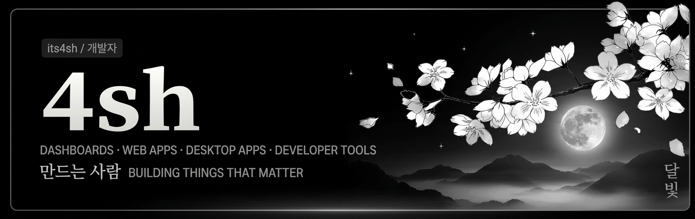
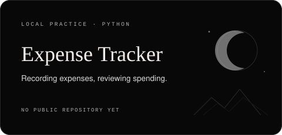
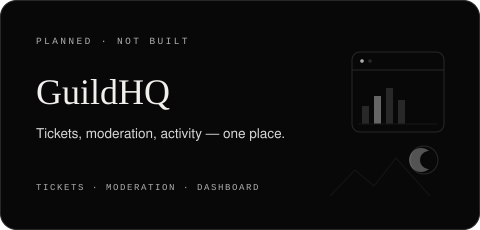

**☾ 4sh · aspiring developer.** I learn by building — small Python programs first, then web applications, dashboards, Discord bots and desktop tools. Most of what I know comes from practice projects, documentation, and rebuilding whatever broke the night before.

I'm a future Computer Science student, not a professional — just someone working steadily toward software that people actually find useful.

  

### ☾ 4sh · Building

  
  

No public repositories yet — these cards describe learning work, not shipped products.

### ☾ 4sh · Learning

- **Python and programming fundamentals** — syntax, data structures, and reasoning clearly about problems.
- **Web applications and dashboards** — interfaces that make information easy to read at a glance.
- **Discord bots and API integrations** — small automations that keep a community running.
- **Desktop applications** — focused tools that live on the machine rather than in a browser tab.
- **Developer tools** — utilities that remove repetitive work.
- **Software engineering** — structure, version control, and the habits that keep a project maintainable.

  

### ☾ 4sh · Setup

I work in **Python**, with **Git** and **GitHub** for every project. Learning happens in documentation, small experiments, and fixing what I broke the night before.

`Python` · `Git` · `GitHub` · `Markdown`

### ☾ 4sh · After Hours

<picture>
  <source media="(prefers-color-scheme: dark)" srcset="https://raw.githubusercontent.com/its4sh/its4sh/output/pacman-contribution-graph-dark.svg">
  <source media="(prefers-color-scheme: light)" srcset="https://raw.githubusercontent.com/its4sh/its4sh/output/pacman-contribution-graph.svg">
  
</picture>

Pac-Man plays across my real contribution calendar, regenerated daily by a scheduled workflow in this repository. 
The animation visualises existing activity — it doesn't create any.

Nothing on this page is simulated, inflated, or backdated.

  

